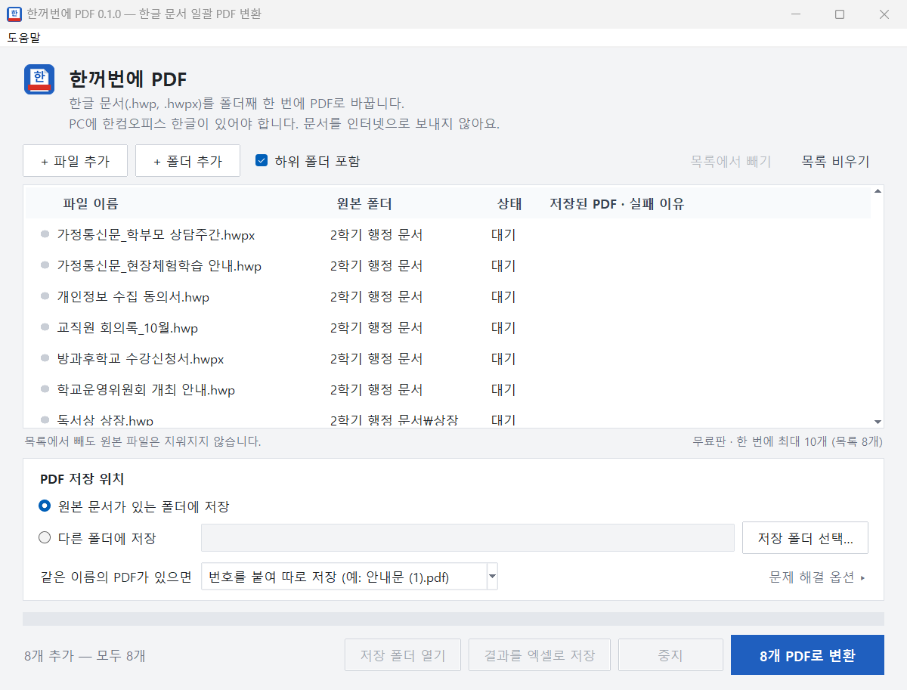

# 한꺼번에 PDF (HanBatchPDF)

한글 파일을 하나씩 열어 PDF로 저장하고 닫는 일을 수십 번 반복하고 계셨다면, 이제 한 번에 끝낼 수 있습니다.

**한꺼번에 PDF**는 HWP·HWPX 문서를 한 번에 PDF로 변환하는 무료 Windows 프로그램입니다. 파일을 골라 넣어도 되고, 폴더째 넣어도 됩니다.

만든 사람: 제이키 · 블로그 [귀찮음이 만든 프로그램](https://blog.naver.com/jabil_free)

## 안심하고 쓰셔도 됩니다

- **원본은 수정하지 않습니다.** PDF만 새로 만듭니다.
- **문서를 인터넷으로 보내지 않습니다.** 서버 업로드가 없습니다.
- **작업 중인 한글 창에는 영향이 없습니다.** 변환에 쓰는 한글은 화면에 보이지 않게 실행됩니다.

## 받아서 실행하기

### 👉 [최신 버전 받기](../../releases/latest)

1. 위 링크를 누른 뒤, 아래쪽 **Assets** 목록에서 `HanBatchPDF`로 시작하는 zip 파일을 받습니다. (`Source code`는 받지 않아도 됩니다.)
2. zip 파일을 오른쪽 클릭해 **압축 풀기**를 합니다. 압축 창 안에서 바로 실행하면 "Failed to load Python DLL"이라는 영어 오류 창이 뜨고 열리지 않습니다.
3. 압축을 푼 `HanBatchPDF` 폴더 안의 `HanBatchPDF.exe`를 실행합니다. 따로 설치할 필요는 없지만, 폴더 안의 다른 파일은 옮기거나 지우지 말고 그대로 두세요.

> [!WARNING]
> **처음 실행할 때 "Windows의 PC 보호" 창이 뜰 수 있습니다.**
> 개인이 만든 프로그램이라 코드 서명이 없어서 나타나는 안내입니다. `[추가 정보]` → `[실행]`을 누르면 실행됩니다.

## 필요한 환경

- 한컴오피스 한글이 설치된 Windows PC (설치된 한글로 변환합니다. 한글 뷰어에서는 동작을 확인하지 않았습니다.)
- 확인한 버전: 한글 2014, 한글 2024 (.hwp, .hwpx 모두)
- 아직 확인하지 못한 버전: 한글 2018, 2020, 2022, 구독형. 사용해 보시고 결과를 알려 주시면 큰 도움이 됩니다.

## 사용 방법

1. **문서 넣기**: 파일이나 폴더를 창에 끌어다 놓거나 `[+ 파일 추가]`, `[+ 폴더 추가]`를 누릅니다. 하위 폴더까지 넣으려면 `[하위 폴더 포함]`을 켜 둡니다.
2. **저장 위치 고르기**: `[원본 문서가 있는 폴더에 저장]` 또는 `[다른 폴더에 저장]`을 고릅니다. 다른 폴더를 고르면 하위 폴더 구조도 그대로 유지됩니다.
3. **변환하기**: 파란색 `[N개 PDF로 변환]` 버튼을 누릅니다.

## 기능 자세히 보기

### 무료판: 10개씩 이어서 변환

- 한 번에 10개씩 변환합니다. 파일 수에는 제한이 없습니다.
- 10개가 끝나면 `[남은 N개 변환]`을 눌러 다음 10개를 이어서 변환합니다. 완료된 파일은 건너뜁니다.

### 동시 변환

- 문서가 3개 이상이면 한글 2개로 나누어 변환합니다.
- 끄려면 `[문제 해결 옵션]`에서 `[한글 여러 개로 빠르게 변환]`을 해제합니다.

### 오류 문서 건너뛰기

- **암호가 걸렸거나 손상된 문서**는 암호 창을 띄우지 않고 '실패'로 표시한 뒤 다음 문서로 넘어갑니다.
- **한 문서가 120초를 넘기면** 실패로 처리하고, 멈춘 한글을 다시 실행해 남은 문서를 계속 변환합니다.

### 그 밖의 기능

- **같은 이름의 PDF가 이미 있으면** 번호를 붙여 따로 저장(`안내문 (1).pdf`), 덮어쓰기, 건너뛰기 중에서 고를 수 있습니다.
- `[중지]`: 변환을 멈춥니다.
- `[결과를 엑셀로 저장]`: 결과 목록을 엑셀에서 열 수 있는 CSV 파일로 저장합니다.
- `[저장 폴더 열기]`: PDF가 저장된 폴더를 엽니다.
- `[목록에서 빼기]`: 목록에서만 뺍니다. 원본 파일은 지워지지 않습니다.
- `[목록 비우기]`: 목록을 모두 비웁니다.
- 완료된 줄을 더블 클릭하면 PDF가 열립니다.

## 알려진 제한

- 그림을 문서에 넣지 않고 파일 경로로 '연결'만 해 둔 문서는 PDF에서 그림이 빠질 수 있습니다. 아직 확인 중인 부분입니다.

## 문의

불편한 점이나 필요한 기능이 있으면 편하게 알려 주세요. 귀찮음을 하나 더 없애는 데 쓰겠습니다.

- 카카오톡 오픈채팅: https://open.kakao.com/o/smcNTRTi
- 블로그: https://blog.naver.com/jabil_free
